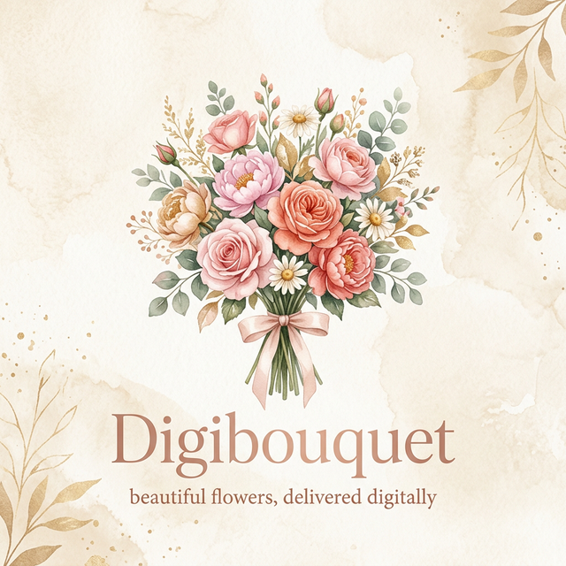

<div align="center">


# 🌷 Digibouquet

**Craft, personalize, and share digital flower bouquets that never wilt.**

<p align="center">
  <a href="https://digibouquet-sooty.vercel.app/"></a>
  
  
  
</p>

<p align="center">
  <a href="#-the-experience"><b>Experience</b></a> • 
  <a href="#-features"><b>Features</b></a> • 
  <a href="#-tech-stack"><b>Tech</b></a> • 
  <a href="#-getting-started"><b>Deploy</b></a>
</p>

---



</div>

<br/>

## 📖 The Story

**Digibouquet** is a modern, interactive web platform where people can design expressive floral arrangements, deeply personalize them, and share them instantly with friends and loved ones. Built with pure JavaScript and a focus on smooth drag-and-drop mechanics, the app provides a playful, emotional, and satisfying gifting experience. It’s completely free, requires no water, and the memories last forever.

> _"For gifting moments that do not fade."_

---

## ✨ Features & Walkthrough

<table>
  <tr>
    <td width="50%" valign="top">
      <h3>🎨 1. Build Mode</h3>
      <p>Start your arrangement by curating a mood. Choose between vibrant full-color bouquets or sleek monochrome styles depending on your recipient.</p>
    </td>
    <td width="50%" valign="top">
      
    </td>
  </tr>
  <tr>
    <td width="50%" valign="top">
      
    </td>
    <td width="50%" valign="top">
      <h3>🌺 2. Smart Picking</h3>
      <p>Select 6 to 10 unique flowers from an expansive library. Not feeling creative? Use quick templates or tap "Surprise Me" for an algorithmic layout.</p>
    </td>
  </tr>
  <tr>
    <td width="50%" valign="top">
      <h3>✨ 3. Interactive Canvas</h3>
      <p>Drag, drop, arrange, and rotate flowers on a dynamic canvas. The app handles natural z-index layering to make your bouquet look professionally composed.</p>
    </td>
    <td width="50%" valign="top">
      
    </td>
  </tr>
  <tr>
    <td width="50%" valign="top">
      
    </td>
    <td width="50%" valign="top">
      <h3>🎀 4. Polish & Share</h3>
      <p>Wrap it up! Add greenery, pick a ribbon, and attach a heartfelt text message. Then instantly download the image, copy it to clipboard, or share a direct link.</p>
    </td>
  </tr>
</table>

### 💎 Additional Gems
- **The Garden**: Explore a community gallery of generated bouquets and save your own.
- **Local Profiles**: Keep an isolated history of everything you’ve created with custom avatars.
- **Micro-Interactions**: Features a dark/light theme toggle, ambient audio mode, celebratory confetti, and fluid page transitions.

<br>

<div align="center">
  
  <p><i>Flawless responsive design for mobile, tablet, and desktop.</i></p>
</div>

<br>

---

## 💻 Tech Stack

Digibouquet is built to be fast, lightweight, and completely decentralized from heavy frameworks. 

- **Bundler**: `Vite 7`
- **Logic**: Vanilla JavaScript (`ES Modules`)
- **Styling**: Modern HTML5 + Custom CSS Variables
- **Exporting**: `html2canvas` for precise screenshot rendering
- **Routing**: Custom Hash-based SPA Router with state transitions

---

## 🚀 Getting Started

Want to run the garden locally? It takes less than a minute.

### Prerequisites
- Node.js 18.x or newer
- npm 9.x or newer

### Installation

```bash
# Clone the repository
git clone https://github.com/yourusername/digibouquet.git

# Enter the directory
cd digibouquet

# Install dependencies
npm install

# Start the dev server
npm run dev
```

Your app will be running at `http://localhost:5173`.

---

## 🌐 Deploying

### Option 1: Vercel (Recommended)
```bash
npm i -g vercel
vercel login
vercel --prod
```

### Option 2: Netlify
Set the **Build command** to `npm run build` and **Publish directory** to `dist`.

---

## 🔍 SEO & Accessibility
- Fully integrated JSON-LD structured data.
- Open Graph imagery, Twitter cards, and semantic HTML structure.
- ARIA accessibility guidelines enforced on custom interactive components.

---

<div align="center">
  <p>Built with ❤️ and ☕. Released under the <b>MIT License</b>.</p>
</div>
